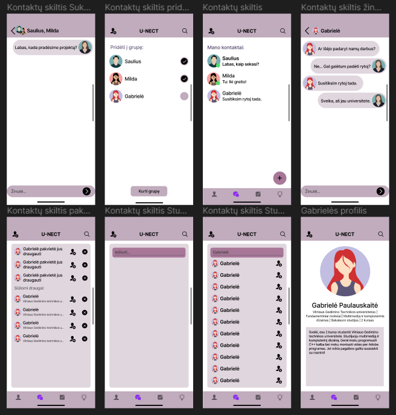
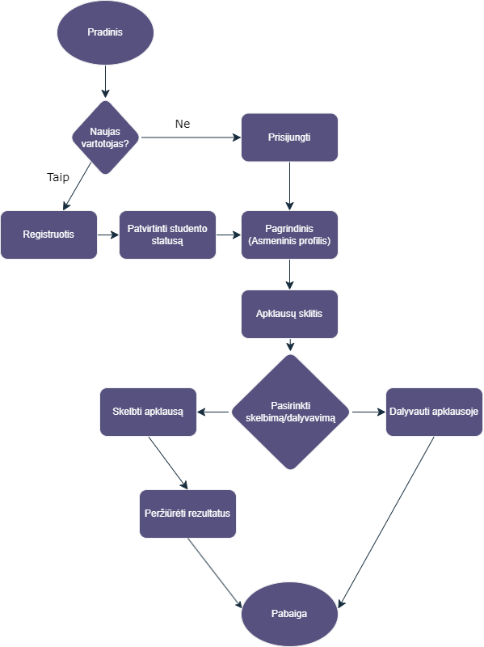
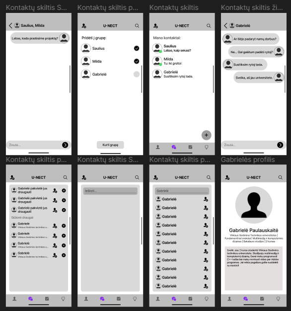
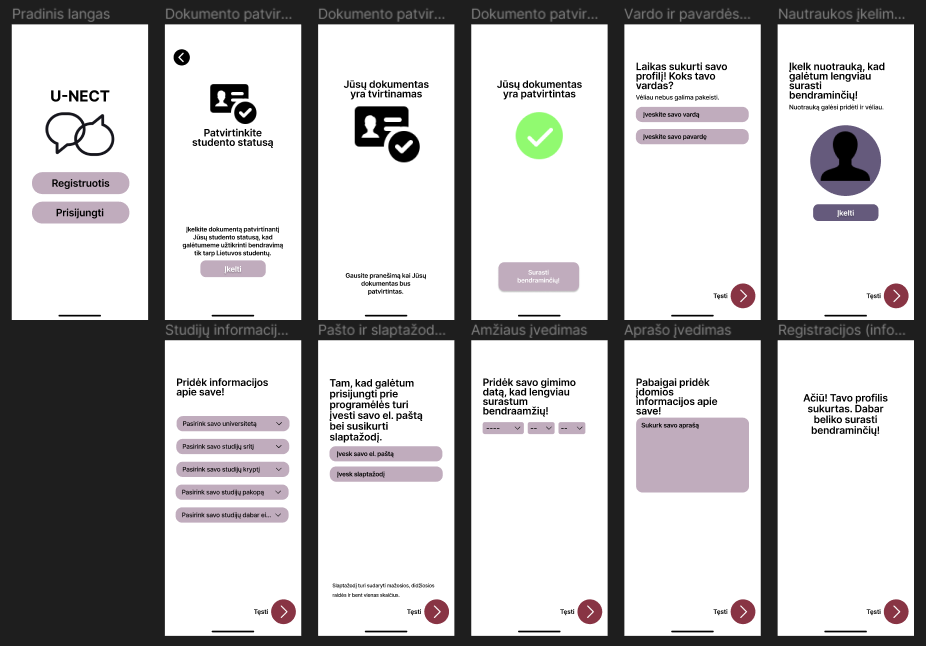
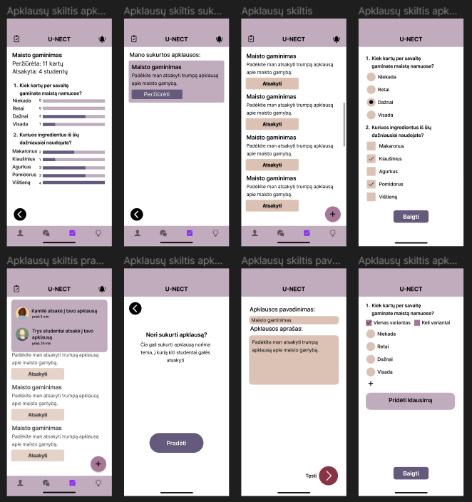
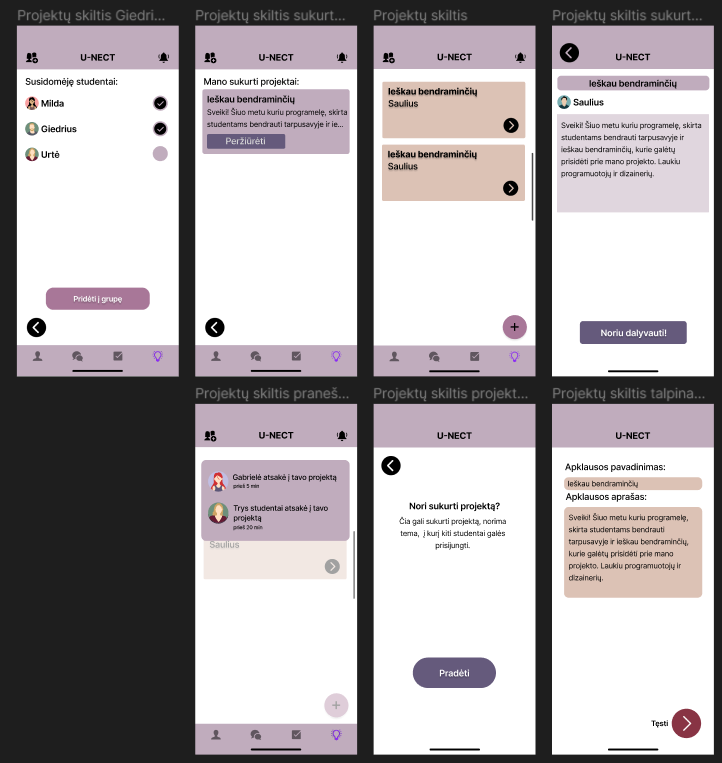
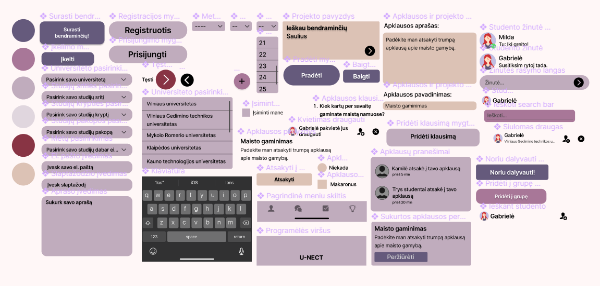
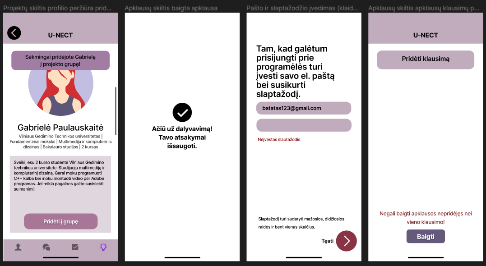

# U-NECT — Student Networking App | UX/UI Case Study

**A mobile app concept helping university students in Lithuania connect, collaborate and find like-minded peers.**

**Project:** Human–Computer Interaction university coursework (2024)  
**Role:** UX research, information architecture, wireframing, UI design and interactive prototyping  
**Tools:** Figma  
**Deliverable:** Interactive mobile app prototype (not a developed or released application)

[**Explore the interactive prototype**](https://www.figma.com/proto/4IKCwYvJ7Z82LSSvYj5RZ7/UNECT-interactive-design?node-id=24-402&scaling=scale-down&page-id=0%3A1&starting-point-node-id=24%3A402) · [**View Figma design file**](https://www.figma.com/design/4IKCwYvJ7Z82LSSvYj5RZ7/UNECT-interactive-design)

## Project overview

U-NECT explores how students from different Lithuanian universities could meet people with shared interests, communicate and collaborate on academic and extracurricular activities. The concept combines **student profiles and connections**, **messaging**, **surveys** and **collaborative project posts** in one mobile experience.

## The problem and design goal

Students may struggle to discover peers beyond their immediate study group or university. The goal was to design an approachable, student-focused space for finding connections and coordinating surveys and projects without relying on unrelated social platforms.

## UX research

- **5 student interviews** explored experiences of meeting peers and needs for social and academic collaboration.
- A **competitive review** considered KiwiLink, Bumble and Pod.ai.
- Research informed **two personas**, representing a student looking for new connections and a student seeking collaborators for projects and activities.

The interviews suggested that users wanted **friendship-oriented connections rather than dating**, alongside convenient ways to share surveys and find project partners. These findings informed the concept and its main navigation sections.

## Design process

### 1. User flows and information architecture

The interaction model covers three representative tasks: **adding a friend, publishing a survey and publishing a project**. Navigation diagrams and task flows helped organize these journeys.

### 2. Sketches and low-fidelity wireframes

I began with paper sketches and translated the flows into grayscale Figma wireframes. This stage focused on screen hierarchy, navigation and functionality before selecting visual styles.

### 3. Visual interface design

The high-fidelity design introduces a **soft pastel palette**, illustrated profile imagery and consistent components across onboarding, messaging, surveys and project pages.

**Onboarding and registration**

**Surveys and responses**

**Projects and collaboration**

### 4. Components and interaction feedback

A small UI component library helped keep controls visually consistent. The prototype also includes feedback and error states, such as confirmation messages and missing-field prompts.

## Usability testing and iterations

I conducted **2 usability test sessions** with participants representing the target personas. Two issues were identified:

| Observation | Design response |
| --- | --- |
| Users could not easily go back or cancel an action in some flows | Added clearer ways to return to the previous or main screens |
| A user could not find how to sign out | Added a sign-out option in Settings |

These changes were incorporated into the high-fidelity prototype. This was a small exploratory test, **not a large-scale usability validation**.

## Interactive prototype

**[Open U-NECT in Figma →](https://www.figma.com/proto/4IKCwYvJ7Z82LSSvYj5RZ7/UNECT-interactive-design?node-id=24-402&scaling=scale-down&page-id=0%3A1&starting-point-node-id=24%3A402)**

The Figma prototype demonstrates navigable screens and selected interactions. Features shown are conceptual and do not represent a working backend or deployed service. Viewing the links depends on the Figma file's sharing permissions.

## Reflection

This project gave me experience moving from early research and user flows to a consistent interactive interface. The usability sessions highlighted the importance of **clear navigation, user control and visible feedback** in even a relatively small prototype.

## About this repository

The images in `screenshots/` were extracted from the original 2024 university report for portfolio presentation. **For sharper visuals, replace them with full-resolution exports from Figma** using the same filenames. Interview transcripts and personal participant details are intentionally not included.

**Author:** Vesta Biveinytė — Multimedia and Computer Design, VILNIUS TECH.
